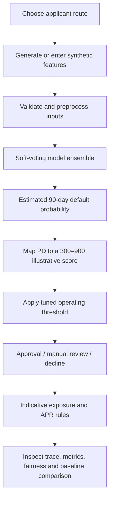

# Alternative Credit Scoring Simulation

An interactive prototype exploring how alternative cash-flow and business signals might supplement limited traditional credit history for **new-to-credit individuals, thin-file borrowers, and MSMEs in India**.

The aim is to make the product and model trade-offs inspectable: who gets evaluated, what signals are considered, how a score becomes a lending decision, and how access and simulated risk are compared. It is **not** a claim that this model outperforms TransUnion CIBIL or a production-ready lending decision system.

**[Open the live Streamlit app](https://alt-credit-scoring.streamlit.app/) · [View the source code](https://github.com/chiraggoyal001/alt-credit-scoring)**

> **Read this first:** this is a simulation using generated data and a transparent, synthetic CIBIL-like baseline. It does not use actual CIBIL scores or internals, live Account Aggregator/UPI/telco/GST/news feeds, or real borrower records. Results describe the assumptions in this simulation—not real-world credit performance.

## The product question

Can a lender make a more useful assessment when a person or small business has limited bureau history, by considering other evidence of cash flow and repayment capacity—while keeping risk, fairness, consent, and explainability visible?

A thin credit file is not itself proof that a borrower is unable to repay. This prototype explores the *design and evaluation questions* behind a supplementary assessment; it does not assume that every available alternative signal is appropriate to collect or use.

## Who the prototype is designed around

| Applicant route | Intended context | Illustrative evidence themes |
|---|---|---|
| **Retail Active** | An individual with a richer financial and behavioural footprint | Inflow stability, obligations, payment regularity, and prior recovery where available |
| **Retail Cold-Start** | A new-to-credit or thin-file individual | Consented utility/payment signals and other illustrative onboarding proxies |
| **MSME Active** | An operating micro or small business | Revenue trends, margins, debt-service capacity, GST consistency, UPI/QR volatility, and working-capital pressure |
| **MSME Cold-Start** | A new or informal business with limited operating history | Promoter and documentation proxies, capital sufficiency, licensing, and sector/cluster context |

These are separate simulated routes because the available evidence and underwriting questions differ by applicant context. The feature lists are experimental; their appearance in the prototype is not an endorsement of their suitability for lending decisions.

## What you can do in the workbench

- **Overview** — inspect portfolio-level measures across the four scoring routes.
- **Score Lab** — enter a hypothetical applicant profile or upload JSON and see its simulated score, 90-day probability of default (PD), decision, exposure limit, indicative risk-based APR, reason codes, and synthetic baseline result.
- **Calculation Trace** — follow routing, input completion, feature diagnostics, ensemble probabilities, score scaling, thresholding, and the downstream exposure/pricing calculations.
- **Testing Data** — evaluate a replacement labelled dataset instead of relying only on the generated sample.
- **Model Comparison** — compare approval and rejection outcomes, approved-borrower default rates, ranking and probability metrics, and exposure proxies.
- **JSON Templates** — download payload templates for single-applicant scoring and labelled evaluation records.
- **Coverage Audit** — review which parts of the concept are represented in the simulation and which remain open design or integration questions.

## How the simulation works



Each route uses a soft-voting ensemble of Gradient Boosting, Random Forest, calibrated Linear SVM, and a shallow Decision Tree, with route-specific weights. Numeric features are imputed and scaled; categorical fields are imputed and one-hot encoded where applicable.

The score is a simple transformation of the model-estimated default probability:

`score = 300 + 600 × (1 − probability_of_default)`

This 300–900 scale is an illustrative presentation layer, not a validated bureau-equivalent score. Approval thresholds, exposure limits, and APR outputs are simulation policies, not lending recommendations.

## Evaluation: what is measured

The comparison code reports multiple views of the problem rather than relying on accuracy alone.

| Lens | Examples in the workbench | Product question |
|---|---|---|
| Access | Approval and decline rates; good-borrower rejection rate | Who could become eligible under this policy? |
| Risk | Default rate among approved/declined; bad-borrower approval rate | What risk does the simulated policy accept? |
| Ranking and probability | ROC AUC, Gini, average precision, Brier loss, precision, recall, accuracy | How well do predictions rank and estimate the generated outcome? |
| Portfolio | Average limit, total approved exposure, expected-loss proxy | What might the policy imply for a hypothetical book? |
| Fairness diagnostics | Selection rate and default rate by audit group; disparate-impact ratio | Are decision outcomes uneven across the generated groups? |

The model-selection objective is deliberately framed as a trade-off: expand simulated access without allowing the approved-borrower default rate to exceed the synthetic baseline where a feasible threshold exists. When no candidate meets the intended constraints, the code falls back to a risk-adjusted operating point and records the chosen point in its reports.

### The baseline is synthetic—not TransUnion CIBIL

The comparator is a transparent formula using a smaller set of variables and configured approval rates. It exists to give the simulation a reproducible reference point. Real CIBIL scoring logic and score-level outcomes are not replicated here, and the project has not been validated on a matched, real-world borrower sample.

For that reason, do not interpret the app's approval lift or simulated default-rate delta as evidence that this model is “better than CIBIL.” The defensible conclusion is narrower: **the prototype demonstrates how an alternative-credit hypothesis could be tested, instrumented, and challenged.**

## Product and responsible-use considerations

Alternative data can add context, but it can also add privacy, consent, proxy-discrimination, and explainability risks. Some variables currently represented in the synthetic generator—such as device characteristics, app composition, typing cadence, geolocation routines, telco/SMS metadata, and inferred stress or literacy—are especially sensitive or indirect proxies.

A production-bound design should not carry these signals forward merely because they improve results on generated data. Each candidate signal would need documented necessity, lawful basis, meaningful consent where required, data minimisation, reliability testing, explainable use, subgroup analysis, and a clear challenge/appeal path. Business cash-flow evidence should be evaluated separately from consumer-device surveillance-style signals.

The current fairness report is a diagnostic, not a fairness certification. Protected/audit fields are excluded from ordinary feature lists, but the synthetic generator deliberately distributes audit groups across simulated risk deciles. A favourable result on this constructed dataset therefore cannot establish real-world fairness.

## Run locally

The live app is available at the link above. To reproduce the simulation locally, use Python 3.9 or newer and run these commands from the repository root.

```bash
git clone https://github.com/chiraggoyal001/alt-credit-scoring.git
cd alt-credit-scoring
python -m venv .venv
```

Activate the environment:

```bash
# Windows PowerShell
.venv\Scripts\Activate.ps1

# macOS / Linux
source .venv/bin/activate
```

Install dependencies, generate data, and train all routes:

```bash
python -m pip install -r requirements.txt
python -m altcredit.cli run-all --rows 5000
```

Start the Streamlit workbench:

```bash
streamlit run app.py
```

Run the test suite:

```bash
python -m unittest discover -s tests
```

For a faster development/smoke-test pass:

```bash
python -m altcredit.cli run-all --rows 1000 --fast
```

The command-line tools also support generating data, training from existing synthetic datasets, scoring a default synthetic applicant, printing JSON templates, showing the calculation trace, and evaluating an uploaded labelled JSON file. See the CLI help or the application’s **JSON Templates** view for payload structure.

### API

Run the FastAPI service after creating the model artifacts:

```bash
uvicorn api:app --reload --port 8000
```

Available routes include `GET /health`, `GET /models`, score/testing JSON template endpoints, `POST /score`, `POST /score/trace`, and `POST /evaluate/testing-data`. The API is part of the prototype; it is not an authenticated or production-hardened lending API.

## Repository map

```text
alt-credit-scoring/
├── app.py                         # Streamlit workbench
├── api.py                         # FastAPI endpoints
├── altcredit/
│   ├── data.py                    # Synthetic dataset generation
│   ├── features.py                # Feature schemas and route definitions
│   ├── feature_engineering.py     # Feature helpers
│   ├── models.py                  # Preprocessing, ensemble training, reports
│   ├── backtest.py                # Threshold tuning and synthetic baseline
│   ├── scoring.py                 # Scoring, decision trace, reason codes
│   ├── comparison.py               # Performance and portfolio comparisons
│   ├── fairness.py                 # Group selection-rate diagnostics
│   └── cli.py                     # Command-line workflows
├── data/synthetic/                # Generated datasets
├── docs/
│   ├── data_dictionary.md
│   ├── problem_structure.md
│   ├── requirements_coverage.md
│   ├── portfolio_case_study.md
│   ├── evaluation_and_governance.md
│   ├── product_roadmap.md
│   └── portfolio_demo_guide.md
├── tests/test_mvp.py
└── requirements.txt
```

Model bundles and run reports are generated under `artifacts/` when the pipeline runs; they are not treated as permanent benchmark results in this README. Regenerate them before discussing any metric values.

## Product management lens

The portfolio value is in making a consequential, ambiguous product problem concrete:

- **Segmentation:** different evidence and constraints for active-history and cold-start retail/MSME routes.
- **Decision design:** a visible trade-off between access and risk, with a manual-review state rather than treating every score as an automatic yes/no.
- **Evaluation:** multiple ranking, calibration, decision, and portfolio metrics to expose trade-offs.
- **Transparency:** a step-by-step scoring trace and reason codes that can be inspected during a demo.
- **Responsible product thinking:** synthetic data boundaries, audit-group diagnostics, and explicit questions about consent, signal necessity, recourse, and deployment readiness.

Supporting notes: [Product case study](docs/portfolio_case_study.md) · [Evaluation and governance](docs/evaluation_and_governance.md) · [Product roadmap](docs/product_roadmap.md) · [Portfolio demo guide](docs/portfolio_demo_guide.md)

## Current limitations and next steps

This is an exploratory MVP. It has no real borrower dataset, real bureau benchmark, live alternative-data integrations, regulatory approval, lender pilot, or validated business impact. The current evaluation also needs a stricter validation design before its metrics can be interpreted as an honest estimate of unseen performance: the operating threshold is tuned on the same held-out partition used for metric reporting. A separate validation partition and untouched final test set should be introduced.

The next iteration should first strengthen experimental validity and signal governance, then validate the most defensible, consent-based data sources with lenders and borrowers. The roadmap document turns these into staged product and model work.

---

*Independent product and technical simulation. Outputs are educational and experimental—not credit advice, a credit bureau score, a lending decision, or evidence of real-world model superiority.*
